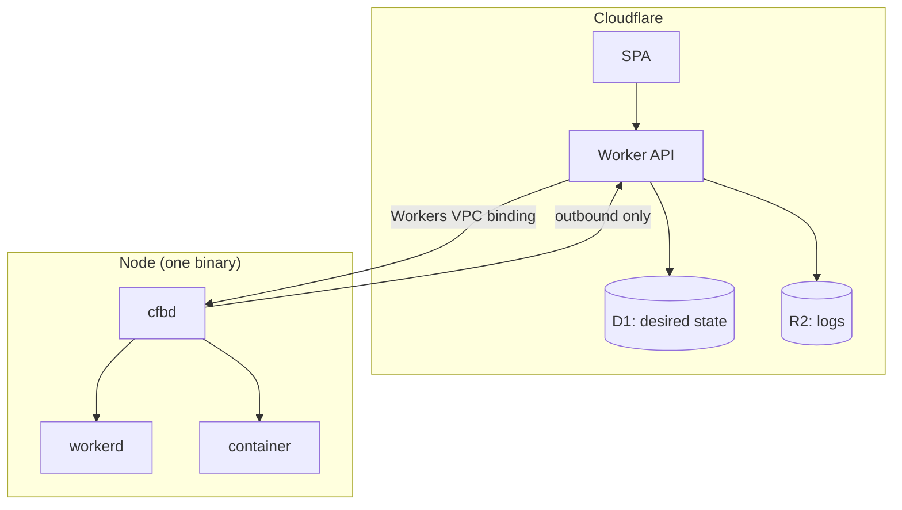

# cfb

Portable workload platform. The same application code runs on Cloudflare or on your own
servers. One agent binary per server carries the tunnel, the broker and the supervisor.

**Revision 4** · 2026-10-29 · 0BSD

---

## Requirements

1. **Portability.** Application source targets one API surface and runs on both Cloudflare and
   a self-hosted runtime. Forks are confined to one adapter module, not spread through the app.
2. **One agent.** A single binary per server is the tunnel connector, the broker and the local
   supervisor. Not a stack of daemons.
3. **The manager stays on Cloudflare.** A Worker serves the SPA and API, and is the only place
   credentials live.
4. **Control plane on Cloudflare, data plane off it.** Cloudflare carries management traffic.
   It does not carry scheduler consensus or machine-to-machine replication.

---

## Design



`cfbd` dials out and holds one connection. The Worker pushes desired state and calls
capabilities over it. Nothing on the node listens on a public interface.

---

## The portability contract

Application code targets the **Portable Workers Subset**: the APIs that run unchanged on both
runtimes.

| Portable | Note |
|---|---|
| ESM `fetch` handler, `env`, `vars` | module syntax only; service-worker syntax is not portable |
| KV | strong consistency differs, semantics do not |
| R2 (S3) | no presigned URLs, no public bucket URL |
| D1 (SQLite) | single-statement `prepare`; no replicas, no `dump()` |
| Queues (produce + consume) | no pull consumers |
| Durable Objects, SQLite storage, alarms | one alarm per object |
| WebSockets + hibernation | reconnect on cell move |
| Service bindings, RPC | no stub passing across isolates |
| Workflows | no `schedules` |
| Cron Triggers | plain expressions |
| HTMLRewriter, WebAssembly, static assets, `waitUntil` | |

Everything else — presigned URLs, the Cache API, `request.cf`, `node:crypto` ciphers, read
replicas — goes through `@cfb/port`, an adapter registry.

Two levels of portability, and only one is a runtime swap:

| Level | Targets | Cost of switching |
|---|---|---|
| Application runtime | Cloudflare, `workerd` (+celld) | one-time; the app itself does not change |
| Capability | storage, sql, queue, sandbox, actors | config only |

Rivet and E2B are **capability** backends, not runtime substitutes — neither runs Workers code.
See [`docs/01-portability.md`](docs/01-portability.md).

**Rule:** a backend check appears in exactly one directory. A lint rule enforces it.

---

## Stack

| Layer | Choice | Why |
|---|---|---|
| Manager | Worker + Static Assets + D1 + R2 | cheap, up when the fleet is not |
| Node agent | **`cfbd`** (one static binary) | tunnel + broker + supervisor in one process |
| Workers runtime | **workerd** (child process) | the actual runtime, Apache-2.0 |
| Containers | containerd or Docker API, whichever is present | no new daemon to install |
| Untrusted code | Firecracker (optional) | microVM isolation when the code is not yours |
| Object storage | **any S3 endpoint**: R2, SeaweedFS, Garage, MinIO | storage is a URL, not a component |
| Overlay (optional) | WireGuard / headscale | only when nodes must talk to each other |

---

## What this is not

| Rejected | Why |
|---|---|
| Nomad | creates no machines, quotas are a no-op in the free build, BUSL-1.1, and its Raft must not cross Cloudflare — the scheduling it provides is not worth a second control plane at this scale |
| Incus / Proxmox | a second API and a second auth model for a job the agent can do with the container runtime already on the host |
| celld | runs one application per fleet, needs a conditional-write bucket, two contributors, beta; used only when a fleet of Workers apps is the actual requirement |
| SeaweedFS as a component | it is a storage *product*; the agent treats storage as an S3 URL, so this is a deployment choice |
| Cloudflare Containers | 4 vCPU / 12 GiB / 20 GB ceiling, 50 GB image budget per account, interruptible hosts |
| Cloudflare Sandbox | instances stop on inactivity by default, no persistent disk |
| Workers Builds | 20-minute hard timeout, 6 concurrent |

---

## Layout

```
README.md                 this file
docs/01-portability.md    the subset, the 13 forks, the adapter registry
docs/02-agent.md          cfbd: process model, protocol, capabilities
docs/03-workloads.md      containers, microVMs, workerd
docs/04-storage.md        storage as a URL
docs/05-control-plane.md  the Worker, the API, reconciliation
docs/06-security.md       trust boundaries, the default-insecure list
docs/07-operations.md     install, upgrade, backup, restore, out-of-band access
docs/08-cost.md           break-even, with the arithmetic
docs/09-roadmap.md        build order
SURVEY.md                 every candidate project, verdict, licence
REVIEW.md                 what changed, and why
```
