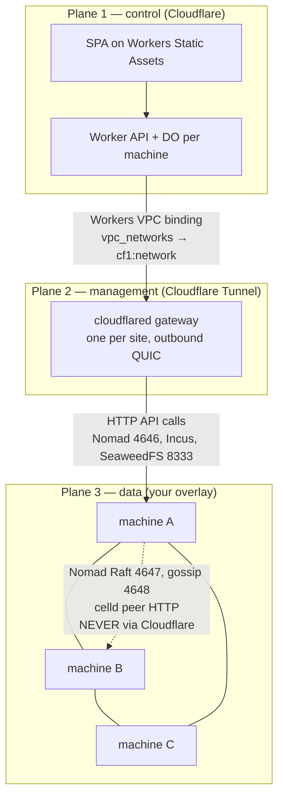

# cfb — an offload architecture for Cloudflare-shaped workloads

**Status:** design spec, revision 1, 2026-10-29
**Licence:** 0BSD

---

## What this is

A specification for running the *machine-shaped* half of a platform on hardware you own,
while the *request-shaped* half — the dashboard, its API, its inventory, its audit log —
stays on Cloudflare Workers.

The premise: Cloudflare is excellent at small, request-shaped work and at global ingress.
It is poor at long-running, stateful, resource-heavy work. Today the expensive line items
are R2, Containers/Sandbox, Workers (as a CI runner) and Durable Objects. This document
replaces the second category, keeps the first, and is honest about which parts are a bad
trade.

Two constraints are fixed and shape everything else:

1. **The manager lives on Cloudflare.** A SPA on Workers Static Assets plus a Worker API.
   Not a container, not a VM, not a self-hosted Next.js app. If the Worker cannot serve it,
   it does not belong in the manager.
2. **Orchestration is not Cloudflare.** Cloudflare may carry the *control* connection.
   It must never be the scheduler, the consensus layer, or the data path between machines.

---

## The stack, in one table

| Slot | Product being replaced | What we use | Licence | Why |
|---|---|---|---|---|
| Control plane | Workers + D1 + DO (as a dashboard backend) | **Cloudflare Workers** (Hono API + Static Assets SPA, D1, one DO per machine, R2 for logs) | proprietary, $5/mo floor | This is the one place Cloudflare is cheap and correct. Keep it. |
| Connectivity | — | **cloudflared** gateway (one per site) + **Workers VPC** binding | Apache-2.0 | Outbound-only; the Worker reaches the private network without a public hostname. |
| Machine-to-machine | — | **headscale + Tailscale** overlay | BSD-3 | Cloudflare Mesh caps at 50 nodes, and the self-hosted DO runtime ships plaintext peer HTTP. |
| Provisioning | Containers / "Computer" | **Incus** (VMs and system containers) | Apache-2.0 | One daemon, one REST API, real VMs and containers behind the same object model. |
| Orchestration | Containers scheduling | **Nomad** | BUSL-1.1 | One binary, no etcd, `batch` + parameterized dispatch maps onto CI exactly. |
| Sandboxed compute | Sandbox SDK | **Firecracker + jailer**, or **E2B Embed** | Apache-2.0 | Hardware isolation per job; E2B is the packaged version of the same idea. |
| Object storage | R2 | **SeaweedFS** (tier 1), **RustFS** (tier 2) | Apache-2.0 | Only OSS S3 clones with working conditional writes. |
| Edge runtime | Workers | **celld** (fleet) / **workerd** (single node) | Apache-2.0 | Runs the `wrangler.json` you already have, including DOs, KV, Queues, D1, R2, Workflows. |

---

## The three-plane rule

This is the single most important design decision in the document, and it is the one most
such designs get wrong. Every connection in the system belongs to exactly one of three planes,
and they use different transports.



- **Plane 1 — control.** Browser to Worker. Same origin, no CORS, no client install.
- **Plane 2 — management.** Worker to a private API, through one tunnel, on demand. Small
  request/response traffic only: submit a job, read status, stream a log tail.
- **Plane 3 — data.** Machine to machine. Raft, gossip, replication, build caches,
  celld peer traffic. This plane never touches Cloudflare, for three reasons: latency,
  blast radius, and the fact that Cloudflare Tunnel carries no UDP and would silently break
  k3s flannel, Nomad gossip and Swarm VXLAN.

A design that collapses plane 3 into plane 2 works in a demo and fails on the first
scheduler election.

---

## Verified constraints that drive the design

These are the numbers that killed the obvious approaches. Each was fetched from the primary
source on 2026-10-29; see [`docs/00-constraints.md`](docs/00-constraints.md) for the quotes.

| Constraint | Value | Consequence |
|---|---|---|
| Container lifetime | no fixed max runtime, but default `sleepAfter` 10 min and 6 h max inactivity timeout | A long build needs a keep-alive you own, and host events can still stop it. |
| Container instance ceiling | 4 vCPU / 12 GiB / 20 GB | **The real blocker.** A large compile does not fit. |
| Container image storage | 50 GB per account | One toolchain-heavy CI image can consume it. |
| Workers Builds | 20-minute hard timeout, 6 concurrent | Not a CI product. |
| Workers memory | 128 MB per isolate | Fine for a dashboard; fatal for anything else. |
| Cloudflare Mesh | 50 nodes per account | Cannot be the machine-to-machine plane for a growing fleet. |
| Cloudflare Tunnel | no UDP on public hostnames; TCP via WebSocket | Rules out k3s, Swarm, Nomad gossip over Tunnel. |
| Workers VPC | public beta, free while beta | The right control path today, with a pricing cliff ahead. |

The honest reading: Cloudflare's compute products are not too expensive for this workload.
They are **too small**, and they interrupt long work. You are not buying a discount, you are
buying a job that survives. See [`docs/09-cost.md`](docs/09-cost.md) — on list prices the two
are close to neutral at realistic utilisation (break-even ~22% duty at a generous 54.6 nodes
per ops person, ~29% at a realistic 10), and the break-even is set by staffing, not by
electricity.

---

## Tiers

The full stack is six systems. Most people need one. Start at the tier that matches the
problem and only move up when a specific constraint forces it.

### Tier 0 — one box, one tunnel

```
machine ── cloudflared ── Cloudflare ── Worker SPA
   └── Docker / systemd units
```

Nomad in single-node mode (server + client on the same host), SeaweedFS single node with a
Postgres filer backend, one `cloudflared`. No celld, no overlay, no Incus. This covers
"replace my CI runner and my S3 bucket" for one or two hosts. It is roughly a weekend.

### Tier 1 — a small fleet

Add headscale for the overlay, Incus for machine provisioning, and a 3-node SeaweedFS.
Nomad stays at one server until you actually need HA. This is the recommended resting point
for a team of one to five.

### Tier 2 — the full offload

Add celld for self-hosted Workers/DO, a 3-server Nomad Raft quorum, Firecracker (or E2B
Embed) for untrusted job isolation, and a second gateway for site redundancy. Only worth it
if you are actually running Workers-style applications of your own.

---

## What this does not solve

Written down because a spec that only lists wins is a sales document.

- **It barely saves money at all.** At realistic utilisation the two options are within a
  few dollars per container-month of each other. The premium buys reliability, not savings.
- **It does not remove the Cloudflare dependency.** The manager is still a Cloudflare
  application. You have moved the expensive, fragile part; you have not left.
- **It does not give you R2's egress economics.** Free egress is R2's single best feature
  and nothing self-hosted reproduces it unless you own your transit.
- **It does not make multi-tenancy safe.** Nomad's resource quotas are a no-op in the free
  build; celld runs one application per fleet; SeaweedFS ships with S3 auth **off**. Jobs from
  different repositories are mutually untrusted and are isolated by microVM, not by the
  scheduler. There is no billing boundary between them.
- **It does not remove the single point of authority.** The Worker holds every substrate
  credential, so a Cloudflare account compromise is a fleet compromise. See
  [`docs/02-connectivity.md`](docs/02-connectivity.md#trust-concentration).
- **It does not beat Fargate on compute.** At a realistic 24% duty cycle, Fargate is cheaper
  than owned metal and needs no operator. Owned metal is justified by egress, by storage
  volume, by data residency, or by a workload no managed platform will accept.
- **It does not survive the bus factor.** SeaweedFS is 54% one person. celld has two
  contributors. headscale is effectively one maintainer. You are signing up to own this.

---

## Repo map

```
README.md                  this file — the architecture and the verdict
docs/00-constraints.md     what is being replaced, with verified numbers
docs/01-architecture.md    the reference build, component by component
docs/02-connectivity.md    the three-plane rule in practice
docs/03-orchestration.md   Nomad and Incus
docs/04-compute.md         Firecracker, E2B, and what "sandbox" should mean
docs/05-storage.md         SeaweedFS, RustFS, and the conditional-write problem
docs/06-edge-runtime.md    celld and workerd on your own metal
docs/07-control-plane.md   the SPA on Workers, and the API it speaks
docs/08-threat-model.md    what an attacker does with each component
docs/09-cost.md            the break-even, with every assumption written down
docs/10-failure-modes.md   what breaks, and what you do at 3am
docs/11-roadmap.md         build order
docs/12-operations.md      backup, restore, out-of-band access, capacity, upgrades
spec/openapi.yaml          the control-plane API sketch
landscape/                 twelve deep code reviews of candidate projects
research/                  eleven research lanes, with sources
critique/                  five adversarial reviews, and what changed because of them
```

## A note on the name

The design borrows its shape from the Electrosphere: a thin, always-present network layer
that everything routes through, with the actual industrial capacity sitting behind it in
buildings you control. Neucom Incorporated organises itself the same way — a small
coordination surface, five departments doing the heavy work, and a slogan about providing
the software that shapes the world of tomorrow. This document is the coordination surface
and the wiring diagram for the departments.

---

*0BSD. Take it, change it, ship it, no attribution required.*
