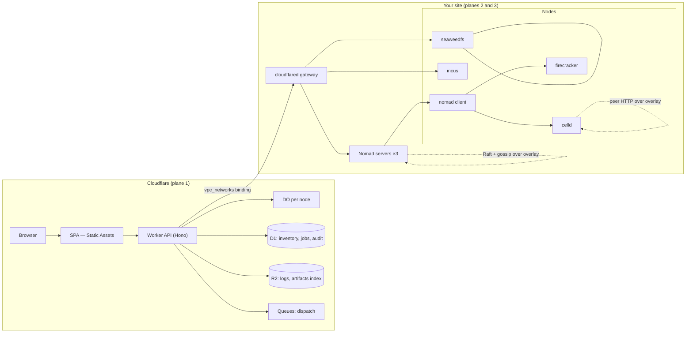
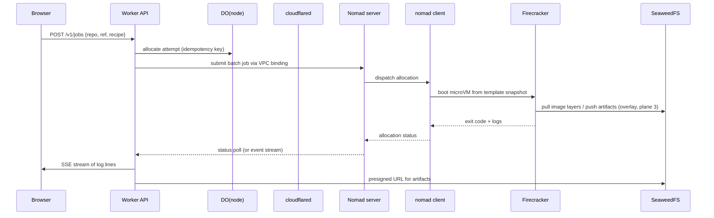

# 01 — The reference build

## The unit of design: a node, not a server

Everything is built around one object, the **node**. A node is a machine you own that has
been enrolled. It is not "a VM" and not "a container" — it is the thing that runs the
software, and it carries a fixed set of daemons:

| Daemon | Required? | Role | Port |
|---|---|---|---|
| `tailscaled` | yes | overlay membership; carries plane-3 traffic | 41641/udp + DERP |
| `cloudflared` | one per site | outbound leg for plane 2 | outbound QUIC 7844 |
| `nomad` client | yes (Tier 0+) | runs jobs | 4647 |
| `incus` | Tier 1+ | creates VMs and system containers | unix socket / 8443 |
| `celld` | Tier 2 only | runs Workers applications | 8080 worker, 8081 internal (9876 is the `celld dev` loopback default) |
| `seaweedfs` | storage nodes | S3 gateway + volumes | 8333, 9333, 8080 |
| `firecracker` + `jailer` | Tier 2, or E2B | microVM isolation | — |

The node's identity is its overlay address plus its Nomad node ID plus (optionally) its
celld node name. The dashboard's Durable Object is keyed on a stable `node_id` you assign at
enrolment, not on any of those — because they change.

---

## Component map



Solid lines are plane 2 and may cross Cloudflare. Dotted lines are plane 3 and must not.

---

## Flow 1 — enrolling a machine

The only flow that needs a human at the machine.

```
1. Operator creates a node in the SPA          → API inserts D1 row (state=pending),
                                                  DO returns a one-time enrolment token
2. Operator runs on the box:
     curl -fsSL https://cfb.example/install.sh | sh -s -- --token <token>
3. install.sh:
     - installs tailscaled, joins the tailnet with a preauth key minted by the API
     - installs cloudflared with a tunnel token (only on the site's gateway host)
     - installs nomad client with a join stanza pointing at the overlay address
     - installs incus, initialises it, and registers the remote in the SPA
     - writes /etc/cfb/node.json {node_id, site, roles[]}
     - POSTs a heartbeat to the Worker over the tunnel
4. API marks the node ready; DO starts a 30 s heartbeat loop
```

The enrolment token is single-use, expires in 15 minutes, and is bound to the `node_id`. It
is the only credential that is ever typed by a human.

**Design note:** the installer must be idempotent and must not need inbound access. Every
step is outbound. This is what makes the design work behind CGNAT and on a residential
connection.

---

## Flow 2 — running a CI job

This is the flow the whole document exists for.



Three things are deliberately not happening:

- **No long-lived Worker request.** The Worker submits and returns. Logs are streamed by
  polling the Nomad allocation API and fanning out through SSE, or by reading the log
  objects from SeaweedFS. A Worker request never waits for a build.
- **No Cloudflare in the data path.** Image pulls and artifact pushes go directly from the
  microVM to SeaweedFS over the overlay.
- **No DO row-per-heartbeat.** Job state lives in D1, updated on transition only. The DO
  holds the lease, not the ledger.

### Why Nomad `batch` and not something else

- `batch` jobs are exactly "run to completion, reschedule on node failure".
- Parameterized dispatch gives one job spec and a per-invocation payload — that is a CI
  trigger with no extra machinery.
- The HTTP API is one port (4646), which is the only port that needs to cross the tunnel.
  Nomad's servers proxy `/v1/client/fs/logs` and `/v1/client/allocation/*/exec`, so you do
  not need to expose 4647 or 4648.
- Rescheduling, draining, and node eligibility are built in. You are not writing a scheduler.

The full review, including the licence boundary and the CORS problem, is in
[`../landscape/07-nomad.md`](../landscape/07-nomad.md).

---

## Flow 3 — deploying a Worker application to your own metal

Tier 2 only. celld runs the `wrangler.json` you already have.

```
1. Operator pushes a Workers app to the SPA's deploy form (or CI calls the API)
2. API runs `wrangler deploy --dry-run --outdir=dist` in a Nomad batch job
   (this is a build step; it runs on your metal, not in Workers)
3. API uploads dist/ to the fleet bucket (SeaweedFS, S3-compatible)
4. API calls POST /reload on each celld node's internal listener over the overlay
5. celld nodes poll deploy/current.json and adopt the new deployment
```

celld needs an object store with **conditional writes, exact ranged reads, and
read-after-write consistency**. SeaweedFS passes this (see
[`05-storage.md`](05-storage.md)); Garage does not and will silently split-brain.

**Hard limit:** a celld fleet runs **one application**. Multi-tenant means one fleet per
application, which means one bucket prefix and one set of nodes per application. Budget for
that before you promise "we'll just run all our Workers internally".

---

## Flow 4 — provisioning a new VM

```
1. Operator picks a profile in the SPA (2 vCPU / 4 GiB / 40 GiB, image ubuntu-24.04)
2. API → Incus REST over the tunnel: POST /1.0/instances {type: virtual-machine, ...}
3. Incus creates the VM on the target cluster member, cloud-init runs the node installer
4. The new VM enrols itself using a token the API embedded in its cloud-init user-data
5. It appears in the SPA as a node, in state=pending, and completes Flow 1
```

Incus's REST API is the cleanest "give me a box" interface in this landscape. It has three
sharp edges that decide how you wire it, all documented in
[`../landscape/08-incus.md`](../landscape/08-incus.md):

- mTLS is unusable through `cloudflared` (no client-certificate origin option), so you must
  use OIDC, and OIDC needs OpenFGA for any role model.
- Incus reads `r.RemoteAddr` only — there is no `X-Forwarded-For` support — so through a
  tunnel every request looks like it comes from the tunnel.
- Operations are an in-memory map: restart the daemon and every in-flight operation UUID
  404s while the containers keep running.

**Therefore:** Incus's API belongs on the overlay (plane 3), and the Worker reaches it via a
small relay service that terminates OIDC and forwards to the unix socket. Do not expose the
Incus API to Cloudflare directly.

---

## State ownership

The most common way this architecture rots is state living in two places. The rule:

| State | Owner | Never duplicated into |
|---|---|---|
| Node inventory, roles, site | D1 | Nomad, Incus |
| Job definition and history | D1 | Nomad (Nomad has the *allocation*, not the intent) |
| Job live status | Nomad | D1 except on transition |
| Machine definition (VM/container) | Incus | D1 except as a cached view |
| Object data | SeaweedFS | R2 |
| Build logs | R2 (small, cheap, and survives losing a node) | SeaweedFS |
| Credentials and tokens | Worker secrets + DO | D1 in plaintext |
| Overlay membership | headscale | — |

D1 holds *intent*. The substrate holds *reality*. When they disagree, reality wins and D1 is
corrected by a reconciler — not the other way round.

---

## Why the dashboard is on Workers and not self-hosted

Because it is the one component whose traffic profile matches Cloudflare exactly: small
requests, global, low CPU, needs to be up when your site is down. A dashboard that lives on
the same hardware it manages is useless precisely when you need it.

The cost is a hard dependency on Cloudflare for the control plane. That is the deal, and it
is a better deal than the alternative: a self-hosted manager that is down whenever the
thing it manages is down.

The 128 MB isolate limit is the constraint to design against. The Worker must never buffer a
build log, a tarball, or a large JSON response. Stream, or presign.

---

## What "manageable from there" means concretely

The SPA must be able to do all of this without an SSH session:

| Action | Path |
|---|---|
| See every node, its health, its jobs | D1 + DO heartbeat |
| Drain a node before maintenance | Nomad `POST /v1/node/<id>/evaluate` + eligibility |
| Submit a job | Nomad `POST /v1/jobs` |
| Read a live log | Nomad allocation logs, streamed through SSE |
| Cancel a job | Nomad `DELETE /v1/job/<id>` |
| Create a VM | Incus REST via relay |
| Delete a VM | Incus REST via relay |
| Create a bucket, set a policy | SeaweedFS S3 API (presigned admin calls) |
| Deploy a Worker app | celld deploy flow |
| Rotate a token | API + DO, revoke on the substrate |
| Read the audit trail | D1 |

If an action needs SSH, it is not in scope of this design and should be called out as such
rather than quietly requiring a shell.
