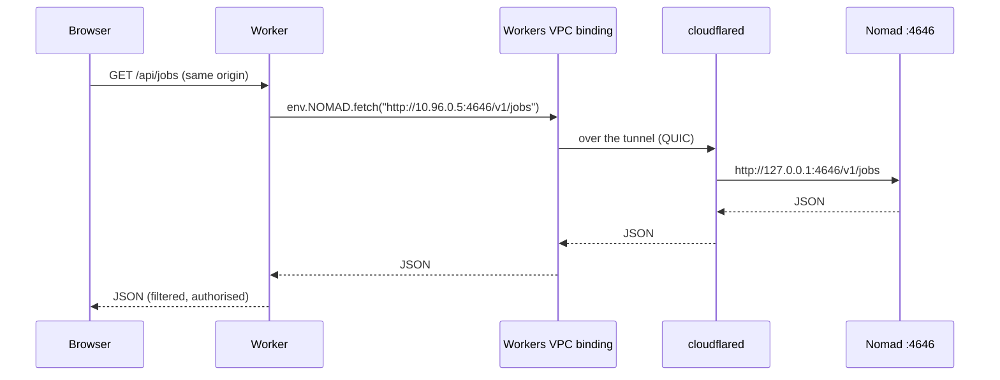

# 02 — Connectivity: the three-plane rule

The design fails or succeeds here. Everything else is a component choice.

---

## The problem, stated precisely

A Worker runs in an isolate on Cloudflare's edge. It has no filesystem, no TUN device, no
UDP, and no route to anything private. Its only outbound primitives are `fetch()` to a
public hostname and `connect()` from `cloudflare:sockets` to a public address and port.

A machine you own is behind NAT, has no public address, and must not be given one.

So the dashboard needs a path from an isolate to a private service, and there are exactly
three mechanisms that exist:

| Mechanism | Direction | Carries | Status |
|---|---|---|---|
| Public hostname on a Tunnel | Worker → CF edge → tunnel → origin | HTTP/HTTPS/TCP/SSH/RDP/SMB over WebSocket | GA |
| Workers VPC (`vpc_services`) | Worker → named host:port | HTTP via `fetch()`, TCP via `connect()` | public beta, free while beta |
| Workers VPC (`vpc_networks`) | Worker → whole tunnel / Mesh / WAN | HTTP via `fetch()`, TCP via `connect()` | public beta, free while beta |

Source: <https://developers.cloudflare.com/workers-vpc/>.

**Workers VPC is the correct answer for plane 2.** It keeps the origin off the public
Electrosphere entirely, which a public hostname does not, and it means the browser never
has to join a private network — no WARP client, no CORS, no mixed content, no Chrome Local
Network Access prompt.

### The nuance that must be stated

"Orchestration is not Cloudflare" is true about *scheduling and consensus*, and false about
*authority*. The Worker holds the substrate credentials, so it is the cluster root: a
compromise of the Cloudflare account is a compromise of the fleet. The rule means "no Raft
traffic through Cloudflare and no Cloudflare component in the scheduling path" — it does not
mean Cloudflare is untrusted. See *Trust concentration* below for the honest accounting.

---

## Plane 2 in practice



`wrangler.jsonc`:

```jsonc
{
  "name": "cfb-manager",
  "main": "src/index.ts",
  "assets": { "directory": "./dist", "binding": "ASSETS" },
  "vpc_networks": [
    { "binding": "SITE", "tunnel_id": "<tunnel-uuid>", "remote": true }
  ],
  "durable_objects": { "bindings": [{ "name": "NODE", "class_name": "NodeDO" }] },
  "d1_databases": [{ "binding": "DB", "database_name": "cfb" }],
  "r2_buckets": [{ "binding": "LOGS", "bucket_name": "cfb-logs" }]
}
```

Then `env.SITE.fetch("http://10.96.0.5:4646/v1/jobs")`.

Bind a **tunnel** with `tunnel_id`, or bind **Mesh** with `network_id: "cf1:network"`. They are different fields, not one field with two value shapes — getting this wrong produces a config that validates and then resolves nothing.

### The five caveats that matter

1. **QUIC only.** Workers VPC requires the tunnel to run QUIC with outbound UDP 7844 open.
   An `http2` tunnel — otherwise perfectly valid for Zero Trust — silently breaks VPC
   resolution. This will cost you an afternoon if you do not know it.
2. **`connect()` is plaintext TCP.** No TLS termination inside the binding. If the target
   speaks TLS you must either terminate at the origin or accept that the hop from Cloudflare
   to your gateway is inside the tunnel anyway (it is), and TLS end-to-end from the Worker is
   not available.
3. **Bindings are static.** `vpc_networks` entries live in `wrangler.jsonc`. Adding a new
   *site* means a Worker redeploy. Adding a new *machine to an existing site* does not,
   because `vpc_networks` binds a whole network. Use `vpc_networks`, not `vpc_services`,
   unless you need to pin a host:port.
4. **A VPC Network binding is an L3 pivot, and the destination is a runtime string.**
   `vpc_networks` lets the Worker reach *any* address in the bound network. If any part of
   that destination comes from a request — a node-supplied callback URL, a user-typed host,
   a value from D1 — you have built a server-side request forgery primitive with a route into
   your private network. See *The allowlist* below.
5. **It is beta and free-for-now.** Design as if it will be priced. The fallback is a public
   hostname plus a Cloudflare Access service token, which is GA and works today; keep that
   path implementable behind a feature flag.

### The allowlist

Every `fetch()` through a VPC binding must go through one function that refuses anything not
on a static list:

```ts
const ALLOWED = new Map([
  ["nomad",   { host: "10.96.0.5", ports: [4646] }],
  ["incus",   { host: "10.96.0.6", ports: [8080] }],
  ["seaweed", { host: "10.96.0.7", ports: [8333] }],
  ["celld",   { host: "10.96.0.8", ports: [8080] }],
]);

function vpcFetch(target: keyof typeof ALLOWED, path: string, init?: RequestInit) {
  const t = ALLOWED.get(target)!;
  const url = new URL(path, `http://${t.host}`);
  if (url.hostname !== t.host) throw new Error("host not allowed");
  if (!t.ports.includes(Number(url.port || 80))) throw new Error("port not allowed");
  return env.SITE.fetch(url.toString(), init);
}
```

No route handler builds a URL from user input. If a feature needs a dynamic destination it
needs a deliberate `vpc_services` binding for that destination — not a string.

### The five-second problem

There is no stream resumption. A QUIC idle timeout kills every in-flight socket. That is
fine for `GET /v1/jobs` and fatal for a long-poll or a WebSocket that expects to survive a
network blip. Consequence: **the Worker must treat every VPC call as idempotent and
retryable**, and long-lived streams must be re-established from the client with a cursor,
not resumed.

---

## Plane 3: why Cloudflare must not carry it

| Traffic | Port/proto | Why Cloudflare cannot carry it |
|---|---|---|
| Nomad Raft | 4647/tcp | latency-sensitive; a WAN hop per append hurts and the tunnel adds a hop |
| Nomad gossip | 4648/tcp+udp | **UDP**; Tunnel public hostnames do not carry UDP |
| k3s flannel VXLAN | 8472/udp | UDP |
| Docker Swarm VXLAN | 4789/udp | UDP |
| SeaweedFS volume replication | 8080/tcp | bulk data; you are paying Cloudflare to move your own bytes |
| celld peer HTTP | internal | plaintext HTTP inside an upgraded stream; needs confidentiality |

Two of these are UDP, which settles it. The rest are settled by cost and blast radius: if
Cloudflare has an incident, your scheduler should keep scheduling.

### The overlay

Use **headscale** (BSD-3, self-hostable coordination server) with the Tailscale client as
the data plane.

Why headscale over Cloudflare Mesh:

- Mesh caps at **50 nodes per account** and 50,000 routes. A CI fleet grows past 50.
- Mesh nodes are Cloudflare-managed agents; headscale is a Go binary you run.
- celld's peer traffic is plaintext HTTP and needs an encrypted overlay regardless; headscale
  provides one, Mesh does not (Mesh gives IP routing, not confidentiality between nodes).

Why headscale over plain WireGuard:

- NAT traversal. WireGuard has none without a coordination server, and you will have nodes
  behind CGNAT.
- Ephemeral key distribution. CI workers come and go; static config does not scale.
- ACLs.

**Caveats, stated plainly:**

- headscale is effectively single-maintainer and ships a hard minimum client version. Pin
  both the server and the client.
- It depends on Tailscale Inc's DERP fleet out of the box for relay when direct NAT
  traversal fails. Run your own DERP if you care; DERP forwards WireGuard ciphertext it
  cannot read, so a third-party relay is a privacy question, not a confidentiality one.
- A Worker cannot be a tailnet node (no TUN, no UDP). The dashboard leg stays on Cloudflare
  Tunnel. The gateway host bridges the two.

Full review: [`../landscape/12-overlay.md`](../landscape/12-overlay.md).

---

## Gateway topology

**One `cloudflared` per site, not per machine.** Reasons:

- Tunnels cost $4.50/month past 1,000, and 1,000 sounds like a lot until every CI worker
  wants its own.
- One connector per site means one process to monitor, one config to rotate.
- `vpc_networks` binds the *network*, so new machines behind the same gateway need no
  Cloudflare-side change at all.

The gateway host runs `cloudflared` plus the relay services (Incus OIDC relay, Nomad auth
proxy) and nothing else. It is a choke point by design, so make it boring, make it
redundant, and do not put workloads on it.

### A second tunnel per site is worth it

Run two connectors on two hosts. `cloudflared` supports up to 25 replicas per tunnel, and
the tunnel survives losing a connector. A single gateway host is a single point of failure
for the entire management plane — the one failure that makes the dashboard useless exactly
when you need it.

---

## Trust concentration

The Worker holds every substrate credential. That is a deliberate trade — it is why the
browser never sees a token — and it has one consequence that must be written down rather than
discovered:

> **A compromise of the Cloudflare account is a compromise of the entire fleet.**

Mitigations that actually reduce the blast radius:

| Control | Effect |
|---|---|
| Scoped tokens per substrate, never one admin token | a stolen Worker secret grants one substrate, not all |
| No delete capability on the storage path from the Worker | storage admin stays a separate credential |
| Cloudflare account: hardware-key MFA, no shared logins, audit-log export | raises the cost of the account compromise |
| A separate break-glass admin identity, held offline | recovery when Access itself is misconfigured |
| Substrate APIs also require the overlay | a Worker-only compromise still cannot reach them without a tunnel |

The residual risk is real and architecture does not remove it. It is the price of the
dashboard living on Cloudflare, and it is stated here so nobody is surprised by it.

## What the browser must never do

- Never join the private network. No WARP, no client install.
- Never hold a substrate credential. Every call goes through the Worker, which holds the
  credential and enforces authorisation.
- Never talk to a private address directly. It cannot, and any design that pretends
  otherwise has a CORS and mixed-content problem waiting.

The Worker is the policy point. That is its whole job, and it is a job an isolate is good at.

---

## Failure behaviour

| Failure | What the operator sees | What still works |
|---|---|---|
| Tunnel down | dashboard shows nodes stale; all actions 503 | running jobs continue; plane 3 unaffected |
| Workers VPC degraded | actions 503 with a distinct code | same as above |
| Overlay partition | node shows unreachable; scheduler rebalances | control plane fine; data plane degraded |
| Cloudflare outage | dashboard gone | entire fleet keeps running; plane 3 fine |
| D1 unavailable | dashboard read-only | substrates unaffected |

The design deliberately makes the *worst* case "I cannot see my fleet", never "my fleet
stopped". That is the entire justification for keeping plane 3 off Cloudflare.
