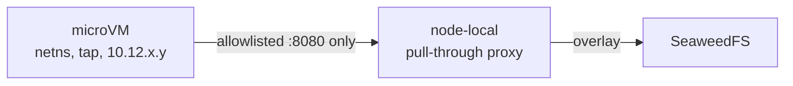

# 04 — Compute: what "sandbox" should mean

Cloudflare's Sandbox SDK is a Durable Object that starts a container. The container is a
Linux VM with its own processes and disk, and it dies when the DO goes inactive. This
document replaces it with something that has the same ergonomics and none of the lifetime
problem.

---

## The three isolation levels, and when each is right

| Level | Mechanism | Isolation | Boot | Use for |
|---|---|---|---|---|
| Process | cgroup + chroot (`nomad exec`) | none | 0 | your own code, trusted |
| Container | namespaces + cgroups (`docker`) | weak | ~200 ms | your own services |
| microVM | KVM + separate kernel (Firecracker) | strong | 125 ms | untrusted code, multi-tenant, agent workloads |

The rule: **anything you did not write runs in a microVM.** A build that executes
`postinstall` scripts from a dependency tree is untrusted code. So is an agent that writes
and runs programs. So is a pull request from a stranger.

Firecracker's own design constraints, from the project's documentation: boot to `/sbin/init`
in ≤125 ms, ≤5 MiB memory overhead per microVM, and — importantly — *"does not perform any
network traffic filtering"*. It is a VMM, not a security product. You supply the jailer, the
network policy, the image pipeline and the snapshot management.

---

## Option A — Firecracker + jailer under Nomad (build it)

The honest option if you are building a platform and want to own it.

```
Nomad batch job
  └── alloc dir
       ├── rootfs.ext4        (built by your image pipeline)
       ├── kernel             (vmlinux, pinned)
       └── config.json        (vcpu, mem, drives, net)
  └── firecracker --no-api --config-file config.json
       └── jailer --id <alloc> --uid <n> --gid <n> --netns <ns>
```

What you get: hardware isolation, 125 ms boot, snapshot/restore at the VMM level, and no
dependency on a vendor's control plane.

What you must build yourself:

1. **Image pipeline.** OCI image → ext4 rootfs. `umoci` + `mkfs.ext4` + a loop mount, or
   reuse E2B's approach.
2. **Network.** Firecracker gives you a tap device and nothing else. You need a /16 host
   CIDR, a slot allocator, veth pairs, and per-slot nftables rules. E2B's orchestrator is
   the best reference implementation of this that is readable.
3. **Snapshot management.** Pause is snapshot + memory file. Resume is restore. Garbage
   collection is your problem, and it will fill your disk the first time you forget.
4. **Scheduling.** Firecracker has no scheduler. This is why it sits under Nomad.
5. **Jailer configuration.** seccomp filters, cgroups, chroot, uid/gid. The defaults are not
   enough and the defaults are also not obviously wrong, which is worse.

This is four to six weeks of work for someone who has done it before, and three months for
someone who has not. Budget accordingly.

---

## Option B — E2B Embed (buy the packaging)

The pragmatic option. `e2b-dev/runtime` is Apache-2.0, and the Embed distribution runs the
whole stack — API, orchestrator, client-proxy, envd, dashboard-api, Postgres, Redis,
ClickHouse — on one machine with no licence key.

**What it gives you:**

- Firecracker orchestration with a real control plane, written by people who do this full
  time.
- Memory snapshots and pause/resume. A sandbox is a resumed snapshot; templates are
  pre-booted VM snapshots.
- Header-based sandbox routing (`E2b-Sandbox-Id` / `E2b-Sandbox-Port`) which drops straight
  behind a single `cloudflared` hostname — no wildcard DNS needed.
- An `s3://` storage seam with `endpoint=` and `s3ForcePathStyle=true`, so it points at
  SeaweedFS instead of GCS.
- A 7,922-line OpenAPI spec you can generate a client from.

**What it does not give you:**

- **Multi-node.** From `embed/README.md`: *"E2B Embed runs the whole E2B stack, every feature
  included, on a single machine"*, and *"When one node is not enough"* leads to a private
  cloud, BYOC, or E2B Cloud. Multi-node is not in the public repo.
- **Persistent volumes.** The volume content API is served by `e2b-dev/belt`, which is
  private (404 on GitHub). The SDK calls it; the server is not open.
- **A dashboard that fits your constraint.** It ships a Next.js 16 SSR app. You are writing
  your own on Workers anyway.
- **TLS.** Embed answers over plain HTTP on the machine's own address. The tunnel is your
  TLS terminator, which is fine, but it means the orchestrator's port 5008 — which is
  **unauthenticated and creates and kills sandboxes** — must never be reachable from the
  gateway host's public side. Bind it to loopback and reach it over the overlay only.

**Sizing:** 12 GiB RAM recommended, 20 GiB disk, 8 sandboxes at full memory or ~20 idle.
Past that, creates fail with *"Failed to place sandbox: this node cannot map 512 MiB of guest
memory"* — that is the hugepage pool, and `HUGEPAGES` is the knob.

**Verdict:** the right choice if you want CI sandboxing this quarter. Wrong if you need a
fleet, because the fleet path is commercial.

---

## Option C — microsandbox (do not use for production)

Reviewed in full at [`../landscape/06-microvm-primitives.md`](../landscape/06-microvm-primitives.md).
It is not a Firecracker wrapper — it pins `msb_krun`, a fork of libkrun — and it is a
484,726-line single-host product with an OCI→ext4 builder, a userspace netstack, and a
snapshot/fork engine.

It has **no seccomp, no namespaces, and no cgroups around the VMM**, which is the whole
security model of a microVM layer. It is a good dev tool and a design reference. It is not
the isolation boundary under untrusted CI.

---

## What a job actually looks like

The Nomad job that runs one CI invocation:

```hcl
job "ci" {
  type = "batch"

  parameterized {
    payload       = "optional"
    meta_required = ["repo", "ref", "recipe"]
  }

  group "build" {
    count = 1
    reschedule { attempts = 2, delay = "30s", delay_function = "exponential" }

    task "sandbox" {
      driver = "exec"
      config {
        command = "/usr/local/bin/cfb-run-sandbox"
        args    = ["--recipe", "${NOMAD_META_recipe}", "--ref", "${NOMAD_META_ref}"]
      }
      resources { cpu = 4000, memory = 8192 }
      # 45 minute ceiling; the supervisor kills the microVM, not Nomad
      kill_timeout = "10s"
    }
  }
}
```

`cfb-run-sandbox` is a small supervisor that:

1. resolves the recipe to an image digest,
2. boots Firecracker from the cached template snapshot,
3. streams the build log to the allocation's stdout (which Nomad captures, and which the
   Worker reads through `/v1/client/fs/logs`),
4. on exit, pushes artifacts to SeaweedFS with a presigned PUT,
5. returns the exit code.

Keep the supervisor dumb. Everything clever belongs in the recipe or in the image.

---

## The lifetime problem, solved

Cloudflare's Sandbox dies when its Durable Object goes inactive, and *"code that runs inside
the instance does not count as activity"*. Three ways this design avoids that:

1. **The job is the unit of lifetime, not a request.** A Nomad allocation runs until the
   process exits, the task is killed, or the node fails. There is no inactivity timer.
2. **The supervisor holds the microVM open.** Firecracker runs as a child process of the
   supervisor; as long as the supervisor lives, the VM lives.
3. **Long jobs get a lease, not a keep-alive alarm.** The Worker records a lease with an
   expiry in the DO; the supervisor renews it every 30 s over the tunnel. If the lease
   lapses the job is *reported* stale, not killed — because killing a build because the
   dashboard could not reach it would be the exact failure mode this design exists to fix.

That third point is the philosophical difference. Cloudflare ties liveness to control-plane
activity. This design ties liveness to the workload itself.

---

## The egress contradiction, and how to resolve it

A job needs to pull an image and push artifacts. A job must also have no route to the node's
overlay address. Those two statements conflict if the job talks to SeaweedFS over the overlay,
which revision 1 of this document glossed over.

**Resolution: the microVM never touches the overlay.** It talks to a node-local proxy.



- The microVM's only route is to the proxy on its own node, on one port.
- The proxy holds the storage credentials; the microVM never sees them.
- The proxy enforces the job's prefix: it can read `images/*` and write
  `artifacts/<job-id>/*`, and nothing else.
- Everything else is dropped by the per-slot nftables rule, including the overlay range and
  the Nomad client API.

This is strictly better than giving the VM overlay access, because the credential never enters
the sandbox and the blast radius of a compromise is one job's prefix.

## Artifacts and caching

| Thing | Where | Why |
|---|---|---|
| Image layers | SeaweedFS bucket `images/` | large, read-heavy, content-addressed |
| Build cache (ccache, cargo, node_modules) | SeaweedFS bucket `cache/` + node-local SSD | network for sharing, local for speed |
| Test results, coverage | SeaweedFS bucket `artifacts/` | needs to outlive the node |
| Build logs | R2 (or SeaweedFS) | small, cheap, and must survive losing a node |

The build cache is the single biggest CI speed lever and the easiest thing to get wrong.
Give each node a local SSD-backed `host_volume` for the hot cache and use SeaweedFS for the
cold tier. A build that pulls its cache over the overlay every time is slower than no cache.

---

## What this costs in complexity

Firecracker under Nomad is roughly:

- 1 image builder (container)
- 1 supervisor (small Go binary)
- 1 network allocator (can be part of the supervisor)
- 1 GC job (Nomad `sysbatch`, runs hourly)
- ~1,500 lines of code you now own

E2B Embed is:

- 21 services and 12 images, 13 host ports, 8 one-shot initialisers, and a privileged
  orchestrator process with `pid: host` and `cgroup: host`

Choose the first if you want to own it, the second if you want it working. Do not pretend
the second is simpler — it is just someone else's complexity, and you still have to operate
it.
