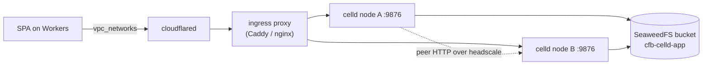

# 06 — Edge runtime: Workers and Durable Objects on your own metal

The question is narrow: can you run the Workers programming model on hardware you own,
including Durable Objects, so that a `wrangler.json` you already have just works?

**Yes, with one project: `denoland/celld`.** It is Apache-2.0, 6,169 stars, at v0.6.3, and it
implements Workers, Durable Objects, KV, Queues, D1, R2, Workflows, Cron Triggers and static
assets from an unmodified Wrangler config.

---

## Why not just workerd

`workerd` is the real runtime — Apache-2.0, ~434k lines of C++/Rust, 236 contributors, daily
releases. It is the correct answer for "run a Worker on this box". It is not a platform.

| Capability | workerd standalone | Needed for |
|---|---|---|
| Serve a Worker over HTTP | yes (`workerd serve config.capnp`) | yes |
| Durable Objects | single-node only; needs a storage backend | yes |
| Distributed DOs | `--experimental` cluster mode, merged 2026-10-29, **in no released binary** | yes |
| Alarms in cluster mode | not wired up | yes |
| KV / R2 / Queue bindings | HTTP shims to services you must write | yes |
| D1 binding | not present | maybe |
| `ctx.container` | Docker-daemon shim, dev only | no |
| Multi-tenant | "single-tenant", unlimited `LimitEnforcer` | depends |

The cluster mode is the important row. It landed on `main` three commits **after** the
newest release (v1.20261029.1), it is gated behind `--experimental`, alarms are unsupported,
and a write is acknowledged only once it is fully synced to the bucket. It
is the first slice of a port of celld into workerd, by celld's own author.

**Conclusion:** workerd is the runtime; celld is the product. Use workerd directly only when
you need one Worker on one box and no Durable Objects.

---

## How celld works

A **node** is one `celld` process. You run one per machine. Every node embeds V8 and executes
Wrangler bundles.

A **cell** is one Durable Object instance, backed by its own SQLite database. A KV namespace,
a queue, a D1 database and a Workflow are each also a cell, so they inherit the same lease,
replication and failover machinery.

The nodes that share one bucket are a **fleet**. The bucket holds the deployments, the cell
state, and small ownership records. There is no membership protocol, no failure detector, no
consensus service:

- **Ownership** is a conditional write of a small record to the bucket. The bucket decides
  who wins. The claim expires unless renewed, so a dead node releases its cells.
- **Replication** uses the LTX write-ahead format. A single node proves durability by
  uploading to the bucket. A fleet of two or more sends the write to one or two peers and
  only then to the bucket, so writes are faster and RPO is still zero.
- **Failover** recovers the open log from the prior owner before restoring a cell.

This is a genuinely elegant design: it replaces consensus with a CAS store, and it is why
the storage requirement in [`05-storage.md`](05-storage.md) is not negotiable.

---

## The five limitations that decide whether it fits

From `docs/limitations.md` and the project's own documentation:

1. **A fleet runs one application.** No account service, no multi-tenant scheduler, no
   managed ingress. Multi-app means one fleet per app: one bucket, one set of nodes.
2. **It needs a qualified object store.** Conditional writes, exact ranged reads,
   read-after-write consistency. SeaweedFS qualifies; Garage does not; RustFS can create but
   cannot CAS.
3. **Peer traffic is plaintext HTTP.** The fleet HMAC authenticates tunnel establishment but
   does not encrypt data. You must supply the overlay — headscale, per
   [`02-connectivity.md`](02-connectivity.md).
4. **It does not terminate TLS.** Put an ingress proxy in front, and keep the internal
   listener on the private network.
5. **Containers are Experimental.** Bound to a DO's lifetime on one node, ephemeral disk,
   images shipped as tarballs through the bucket. Not a CI runner, not for long-lived
   services. Do not confuse this with the compute layer in [`04-compute.md`](04-compute.md).

---

## Deployment shape

- Ingress proxy terminates TLS and forwards to each node's worker listener on 8080 (`--listen 0.0.0.0:8080`); the internal/peer listener is 8081 (`--internal-listen`), bound to the overlay address only.
- Peer listener stays on the overlay, never on the tunnel.
- The bucket is a dedicated SeaweedFS bucket per fleet, with credentials scoped to that
  bucket alone.

`wrangler.jsonc` is unchanged from what you would deploy to Cloudflare. That is the whole
point: `celld deploy` reads it, bundles it, uploads the deployment, and every node adopts it
on its next poll (default 30 s).

---

## Operating it

| Task | How |
|---|---|
| Deploy | `celld deploy` → new deployment in the bucket; nodes adopt on poll |
| Force adopt | `POST /reload` on the internal listener |
| Inspect | `GET /state` reports resident objects and their deployment |
| Scale | start or stop `celld` processes; cells hand off |
| Health | readiness stays closed until the fleet settles; set an orchestrator rollout deadline |

**celld does not scale itself.** From its documentation: *"An external system starts and
stops the nodes, and celld hands the cells off."* That external system is Nomad — a `service`
job per node, with a restart policy. This is the clean seam between the two layers.

---

## Governance, stated plainly

- 2 contributors, 14 squash commits at v0.6.3, zero published tests, PRs disabled.
- 63 MiB binary, 419 crates, 176 environment variables.
- Beta. The version number is honest about it.

This is a young project with a genuinely good design. Treat it as you would any
single-author distributed system: pin the version, read the guarantees document, test your
storage backend against the CAS requirement before you trust it with state, and keep the
blast radius small — one application per fleet is also a good safety property.

---

## When to adopt it

**Not first.** The order in [`11-roadmap.md`](11-roadmap.md) puts celld last, after CI and
storage, for a reason: it is the least mature component and the least urgent. Workers
applications you already run on Cloudflare keep working on Cloudflare, at $5/month, with
zero operational burden. Moving them is an optimisation, not a fix.

Adopt celld when one of these is true:

- You are running enough Workers traffic that the per-request bill matters.
- You need a Worker to reach something that only exists on your network, and Workers VPC is
  not enough.
- You want the DO programming model for internal state that must not leave your premises.

Otherwise leave it alone.
